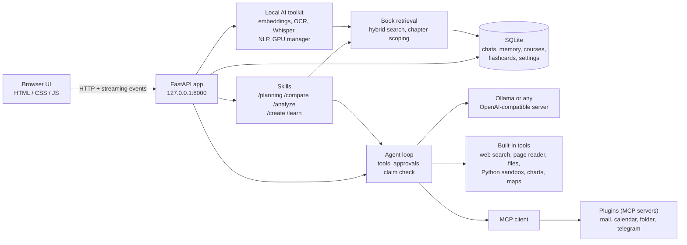
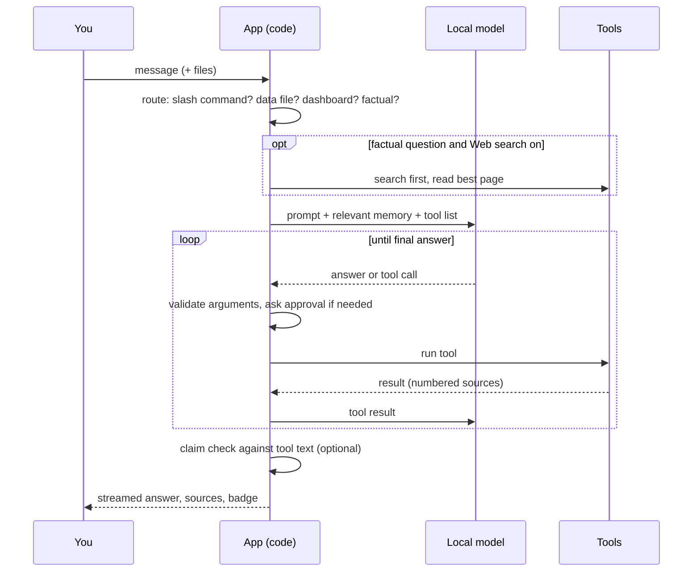
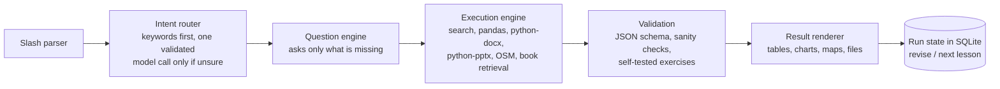
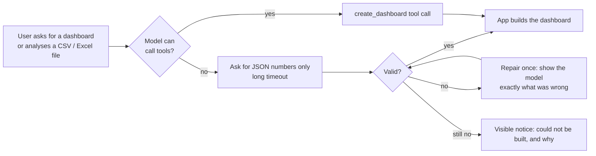
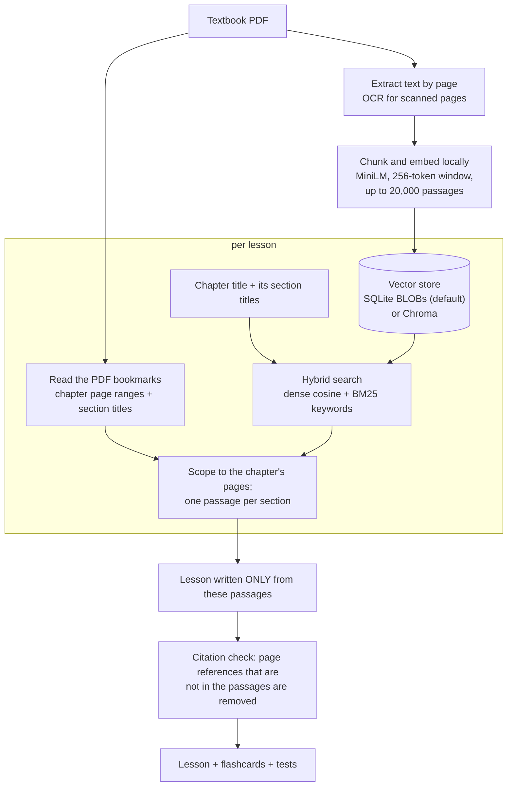
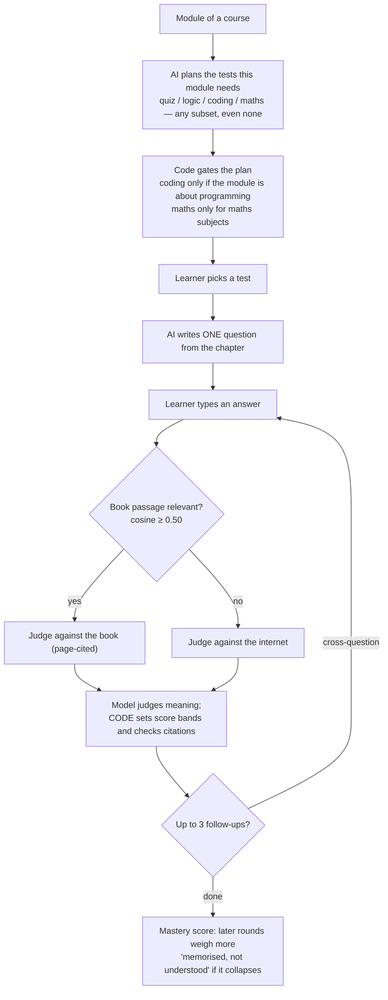
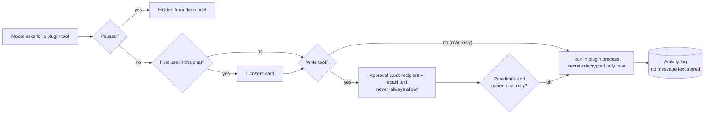

# Local Chat

### Give a local AI model a body.

A local language model on its own is an *engine*: run it in Ollama or LM Studio and you get a chatbot that talks well but cannot do much. **Local Chat is the suit built around that engine** — current information from the internet, access to your mail, calendar and files, planning, budgeting, comparing options, learning from your own books, and analysis of your data — so a model running on your own computer becomes something you can actually use in everyday life.

It runs entirely on your machine, with any local model through [Ollama](https://ollama.com) or an OpenAI-compatible server such as LM Studio. No cloud AI service, no accounts, no telemetry. The only internet use is what you switch on yourself: web search, page reading, and downloading models and libraries.

> **Status: working prototype / portfolio project.** Everything described below is implemented and covered by automated tests, but several parts have only been tried on one laptop and a handful of models. See [What was tested](#what-was-tested) and [Under testing](#under-testing--not-verified-yet) before relying on it, and read the [warning about small models](#warning-small-local-models-are-unreliable-tool-users).

**Stack:** one FastAPI process (Python) · plain HTML/CSS/JavaScript front end (no build step) · SQLite · bound to `127.0.0.1` only.

## Contents

1. [Why this project exists](#why-this-project-exists)
2. [What it does](#what-it-does)
3. [Architecture](#architecture)
4. [The AI stack: what is used, and why](#the-ai-stack-what-is-used-and-why)
5. [Features in detail](#features-in-detail)
6. [Learning hub](#learning-hub)
7. [Plugins and security](#plugins-and-security)
8. [Install and run](#install-and-run)
9. [What was tested](#what-was-tested)
10. [Under testing / not verified yet](#under-testing--not-verified-yet)
11. [Warning: small local models are unreliable tool users](#warning-small-local-models-are-unreliable-tool-users)
12. [Known limits](#known-limits)
13. [Roadmap](#roadmap)
14. [Project layout](#project-layout)
15. [Privacy and data](#privacy-and-data)
16. [Contributors and credits](#contributors-and-credits)
17. [License](#license)

---

## Why this project exists

Local models solve real problems — privacy, cost, working offline, owning your data — but used raw they have hard limits, and most of those limits come from how they were trained:

- Their knowledge stops at the day training ended, so they cannot tell you what happened last week.
- They invent facts, figures and sources with total confidence.
- They know nothing about *your* life: your inbox, your schedule, your documents, your books.
- They are unreliable at arithmetic, data and multi-step jobs, and small models often fail at calling tools at all.
- They forget you between conversations.

Think of the model as a person and this project as an **Iron Man suit**: the person is unchanged, but wearing the suit they can do things they could not do alone. Local Chat does not try to make a 9-billion-parameter model smarter than it is. It wraps the model in an application that **compensates for each weakness with ordinary, reliable code**:

| A bare local model… | …so Local Chat adds |
|---|---|
| has a knowledge cut-off | **Web search and page reading**, search-before-answering for factual questions, deep research with citations |
| makes things up | a **claim check** against what the tools actually returned, numbered sources, and entity cards whose facts must appear verbatim in the fetched page |
| cannot see your life | **plugins** for mail, calendar, a folder of files and Telegram — read-only by default, with approval cards for anything that writes |
| is bad at numbers and data | **pandas, sympy and charting done by code**: dashboards, statistics and maths are computed, not guessed |
| fumbles multi-step tasks | **skills** (`/planning`, `/compare`, `/analyze`, `/create`, `/learn`) where code controls the steps and the model only writes text, with its JSON validated |
| does not know your documents | **RAG over your own books and PDFs**, page-cited, scoped to the chapter being taught |
| cannot use tools (reasoning models) | a **JSON-extraction path** so dashboards and analysis still work |
| forgets you | **memory** recalled by relevance, preferences you can inspect and edit |
| cannot help you learn over time | a **learning hub**: courses from your textbook, spaced-repetition flashcards, tests, answer checking |

**What you can do with it day to day:** plan a trip or a study timetable and budget it, compare phones, universities or job offers, summarise your latest mail, ask about your calendar, learn a subject from a textbook you own and be tested on it, analyse a spreadsheet and get a dashboard, research a topic with cited sources.

**What it is not:** a competitor to frontier models such as GPT or Claude. The aim is narrower and more practical — **to make local models useful in daily life**, on a normal laptop, without sending your data anywhere.

---

## What it does

| Area | In one sentence |
|---|---|
| **Chat** | Streaming replies, markdown, code highlighting, maths (KaTeX), diagrams (Mermaid), edit / retry / branch, thinking mode for reasoning models. |
| **Tools the model can use** | Web search, page reading (with a real browser fallback for JavaScript pages), file reading incl. OCR, a sandboxed Python runner, charts, maps, MCP servers, n8n, LibreOffice conversion. |
| **Charts and dashboards** | The model supplies plain numbers; the app draws 30+ chart types and fixed-layout dashboards. Reasoning models that cannot call tools are handled by a JSON-extraction path. |
| **Skills** (`/planning` `/compare` `/analyze` `/create` `/learn`) | Task workflows where *code* controls the steps and the model only writes text. |
| **Learning hub** | Upload a textbook PDF and get a course: page-cited lessons, flashcards with spaced repetition, and per-module tests (quiz, logic, coding, maths) chosen by the AI only when a module needs them. |
| **Deep research** | Plan → search → read → notes → cited report, with every step visible. |
| **Accuracy layer** | Factual questions are searched *before* the model answers; the finished answer is checked against the sources. |
| **Local AI toolkit** | Embeddings, semantic search, OCR, offline speech-to-text, NLP, vision routing, a GPU manager. |
| **Plugins** | One-click MCP connections: Mail, Calendar and Folder (read-only), Telegram bot (two-way with limited, approval-gated writing). |

The guiding rule of the whole project: **the app owns the control flow; the model fills in text.** Calculations, schedules, scores, retrieval, validation, permissions and file generation are done by deterministic code. The model interprets, extracts and writes — and its output is validated before it is used.

---

## Architecture

### System overview



### One chat turn



### Skills: code decides, model writes



### Dashboards for models that cannot call tools

Reasoning models such as `deepseek-r1` often cannot use tool calling. Instead of waiting minutes and then receiving dashboard *code*, the app asks once, in JSON mode, for just the numbers, validates them, and builds the dashboard itself.



The "ask, check, retry" loop exists twice: the app's built-in loop (default) and an equivalent **LangGraph** state graph (`ask → check → retry or end`) selectable in Settings. A test runs both on the same scripted replies and requires identical results.

### Book retrieval (the RAG behind `/learn`)



### The Test-me / answer-checking loop



### Plugin security



---

## The AI stack: what is used, and why

**No model was trained or fine-tuned for this project.** It improves a model's usefulness by what surrounds it, not by changing it. Each choice below was made for a reason, and where a popular tool is *not* in the core path, that is said plainly.

### The model runtime
| Piece | What it does here | Why |
|---|---|---|
| **Ollama / LM Studio** (OpenAI-compatible API) | Runs the language model | Engine-agnostic: any model you can run locally can be plugged in. The app's own client (`backend/llm.py`) streams replies, uses native tool calling when a model supports it, and JSON mode when it does not |

### The agent
| Piece | What it does here | Why |
|---|---|---|
| **A hand-written agent loop** (`backend/agent.py`) | The model asks for a tool, the app validates the arguments, asks for your approval when needed, runs it, numbers the sources and feeds the result back; repeats until the answer is final | Small local models fail in unusual ways (ignoring tools, malformed JSON, endless thinking). A custom loop lets every step have a timeout, a repair attempt and a *visible* failure notice, and lets 400+ tests drive it with scripted model replies. A general agent framework would hide those steps |
| **Retrieve-then-answer ("ground first")** | For factual questions the *app* searches and reads the best page before the model answers | A local model's own memory is stale; reading first beats asking it to remember |
| **JSON extraction + repair** | For models that cannot call tools, the app asks once in JSON mode for just the numbers, validates, and shows the model its own mistake once if needed | Makes dashboards and analysis work with reasoning models like `deepseek-r1` |
| **Claim check** | Numbers, names and dates in the answer must appear in the tool text; unsupported ones are flagged or removed | Cuts confident invention (measured 26 → 30 correct of 32 on `qwen3.5:9b`) |

### RAG (retrieval-augmented generation) and vector search
| Piece | What it does here | Why |
|---|---|---|
| **RAG written from scratch** (`backend/skills/book.py`) | Reads a PDF by page, reads its bookmarks, chunks and embeds it, retrieves per lesson, checks citations | The first, generic version of book retrieval gave weak lessons. Measuring it showed the fix was *structure*, not a bigger model: use the PDF's own chapter page ranges and section titles, take one passage per section, and remove citations that are not in the passages |
| **Embeddings: `paraphrase-multilingual-MiniLM-L12-v2`** via sentence-transformers | Turns text into vectors | Small (~470 MB), multilingual (English / Hindi), runs on a 6 GB GPU beside the chat model, falls back to CPU |
| **BM25** (`rank-bm25`) | Keyword scoring fused with the dense scores | Exact terms and names that embeddings blur |
| **Vector database: SQLite BLOB vectors (default)** | Stores vectors and does exact cosine search | Zero setup, no server, exact (not approximate) results, fast enough at the tested scale (~11,600 passages per book) |
| **Vector database: Chroma (optional)** (`backend/vectorstore.py`) | Same interface, HNSW index with metadata filtering | Lets the two approaches be compared on the same data with `scripts/eval_retrieval.py`. *Not run for real on the development laptop (blocked by Windows Application Control); verified only behind a fake* |

### LangChain and LangGraph
| Piece | What it does here | Why — and honestly |
|---|---|---|
| **LangChain** (`langchain-core`, `backend/integrations/langchain_rag.py`) | `BookRetriever` and `StoreRetriever` expose the app's retrieval as standard LangChain retrievers | Interoperability: the same retrieval can be dropped into LangChain pipelines. It is **not** in the core path; a test checks it returns the same results as the native code |
| **LangGraph** (`backend/integrations/langgraph_flows.py`) | The "ask → check → retry or end" dashboard builder as a state graph, selectable in Settings | Shows graph-style orchestration with an inspectable state machine. For a two-node loop it adds nothing the plain code does not already do (a test requires identical results); its value would appear with larger, branching, resumable flows |

### Deep-learning libraries
| Piece | What it does here | Why |
|---|---|---|
| **PyTorch** | Runs the embedding model (via sentence-transformers); the GPU manager uses it to detect CUDA and read free VRAM; its CUDA libraries are also what the speech engine needs on Windows | Needed for GPU embeddings. **Nothing is trained with it** |
| **faster-whisper** (CTranslate2) | Offline speech-to-text, English / Hindi / Hinglish mode | Fast on a 6 GB GPU (9 s of audio in 1.5 s), int8 on CPU as fallback; loaded per recording and released |
| **RapidOCR** (ONNX Runtime, CPU) | Reads images and scanned PDFs | Runs on the CPU so the GPU stays free for the chat model |
| **GPU manager** (`backend/gpu.py`) | One heavy GPU job at a time, CUDA only when ≥ 700 MB VRAM is free, otherwise CPU with the reason shown; never unloads Ollama | A 6 GB card is shared by the chat model, embeddings and speech |

### Classic NLP, data and maths
| Piece | What it does here | Why |
|---|---|---|
| **spaCy, scikit-learn, langdetect** | Entities, keywords, language and intent detection, similarity (CPU) | Rule-based and small models where an LLM call would be slow and unreliable |
| **pandas, matplotlib, sympy** | Statistics, charts, checked maths problems | **Numbers are computed by code**, never trusted from the model |

### Connections and the web
| Piece | What it does here | Why |
|---|---|---|
| **MCP (Model Context Protocol)** | Every plugin (mail, calendar, folder, Telegram) is an MCP server | An open standard: the plugins work with other MCP clients too, and the app can use any third-party MCP server |
| **Crawl4AI** | Renders JavaScript-built or bot-blocked pages in your installed Edge/Chrome | Many modern pages are empty to a plain HTTP reader |
| **Web search + page reader** | Gives the model current information | The single biggest fix for the training cut-off |

---

## Features in detail

### Chat and composer
Streaming, markdown, syntax highlighting, KaTeX, Mermaid, edit / retry / regenerate, branching conversations, stop generation. The **+** button holds *Attach files* and the switches *Web search*, *Deep research* (next message only), *Thinking*, and per-chat MCP server switches. Side panel: HTML pages (sandboxed iframe), SVG, Markdown and dashboards open beside the chat.

### Charts
The model never writes chart code: it calls `create_chart` with plain data. Bar, stacked, 100 %-stacked, line, step, area, slope, pie, donut, scatter, bubble, dot, histogram, radar, polar area, waterfall, funnel, gauge, box plot, candlestick, heatmaps, treemap, sankey, network, directed, knowledge, dependency, tree and ER graphs. Flowcharts and sequence diagrams use Mermaid. Export: dashboard to PNG (composed from the spec, not a screenshot), copy as image, CSV, JSON, per-chart PNG; flowcharts to PNG / SVG / clipboard.

### Dashboards and data analysis
Ask for a dashboard in plain words or attach a CSV / Excel file and say "analyze this". The app computes the figures with pandas and picks a template (`sales`, `financial`, `hr`, `marketing`, `ecommerce`, `executive`, `operations`, `customer`, `general`): header, 4–6 KPI cards, charts (trend full width, others two per row) and one table. Estimated or repeated charts are refused. `/analyze` always draws charts when statistics are involved and adds a dashboard when you ask for one or the data has several dimensions.

### Skills (`/planning`, `/compare`, `/analyze`, `/create`, `/learn`)
| Command | Internal workflows | Result |
|---|---|---|
| `/planning` | travel, academic timetable, entertainment, event, schedule | itinerary with interactive map, timetable with progress tracker, calendar, budget, `.ics` / `.csv` / `.docx` |
| `/compare` | any options; finds candidates if only a category is named | side-by-side table, explicit weighted criteria, recommendation |
| `/analyze` | spreadsheets / CSV, documents (PDF, Word, text) | KPIs, charts, data-quality report, trends, anomalies, relationships (r, R²), cleaned CSV + Word report |
| `/create` | document, presentation, dashboard, code, creative text | real `.docx` / `.pptx` / `.zip` files |
| `/learn` | course, explain, interview prep | see [Learning hub](#learning-hub) |

The app asks only the questions it is missing, reuses earlier answers, uploaded files and saved preferences, and stores run state in SQLite so a run can be revised or continued. Feedback (👍/👎 + comment) becomes **stored preferences** you can view, edit and delete under *Library → Skill preferences* — it does **not** retrain the model. Nothing is ever booked, bought or paid: links open the provider's own pre-filled search page. Maps use OpenStreetMap (Nominatim + OSRM, free, cached, rate-limited; falls back to a labelled straight-line estimate).

### Deep research
Switch on for one message. Five stages run in code: plan sub-questions → search each → read the best pages and take notes (plus one gap check) → synthesise → write a cited report. Every search and page read is a visible tool row.

### Accuracy layer
- **Ground first:** for factual or time-sensitive questions with Web search on, the app searches and reads the best page *before* the model answers. Calculations, code and creative requests are not searched.
- **Claim check** (`off` / `flag` / `fix`): numbers, names and dates in the answer are compared with what the tools returned; unsupported ones are flagged (or removed by a constrained rewrite) and a badge shows the result.
- Measured on `qwen3.5:9b`, 32 questions: plain **26** correct → web-grounded **30** (recent-events questions 7 → 11 of 12). A closed-book self-check did not help and was dropped.

### Memory, assistants, projects
Say "remember that …" / "forget …" (the app handles it, not the model), or let the model call `save_memory`. With 8+ memories, the ones most relevant to your message (plus the 3 newest) are used. A reworded version of a saved fact replaces it (cosine ≥ 0.93); contradictions are kept as separate memories because embeddings cannot tell them from different facts. Custom assistants and projects (shared instructions and files) live in **Library**. The sidebar search also finds chats by meaning. Passwords and keys are never stored in memory.

### Local AI toolkit (all optional, every feature has a fallback)
| Feature | How |
|---|---|
| **Embeddings / semantic search** | multilingual MiniLM via sentence-transformers |
| **GPU manager** | detects the GPU, reads free VRAM, runs one heavy task at a time, picks CUDA only when it works and ≥ 700 MB margin is free, otherwise CPU with the reason shown. Ollama / LM Studio are only *read*, never unloaded or stopped |
| **Voice** | faster-whisper, offline; English / Hindi / Hinglish mode; text goes into the message box so you can edit it |
| **OCR** | RapidOCR on CPU for images and PDFs (text layer used when present); scanned files are also read automatically |
| **Vision** | routes an image to describe / screenshot / diagram / chart / document / formula using the *selected chat model* when it can see images |
| **NLP** | language (English / Hindi / Hinglish), intent, entities, keywords, sentiment, similarity, summarise — CPU, rule-based where noted |
| **Entity cards** | ask about a named person, product, place, vehicle, company… and the *app* (not the model) looks it up on Wikipedia / Wikidata / Wikimedia Commons / the web; web-derived specs and prices are kept only if they appear verbatim in the fetched page; images are linked with credit, never re-hosted |
| **Hard pages** | when plain HTTP is blocked (403/429/503) or a page is built by JavaScript, [Crawl4AI](https://github.com/unclecode/crawl4ai) renders it in your installed Edge/Chrome |

### Connections: MCP, n8n, LibreOffice
**MCP** servers (local command, streamable-HTTP or SSE) join the chat as `mcp__<server>__<tool>`; tools not marked read-only ask for approval (Allow / Always allow / Don't allow). **n8n**: the app can create *draft*, inactive workflow templates (Gmail / Calendar MCP triggers) with no credentials — you attach your accounts in n8n. The node settings follow n8n's documented node types but were **not** run against a live n8n. **LibreOffice**: a `convert_document` tool converts docx/xlsx/pptx/odt to pdf, csv and more.

### Import / export
Settings → Data: import this app's JSON export, ChatGPT's `conversations.json` (branches kept) or Claude's export; export all chats or the library.

---

## Learning hub

`/learn` builds a **course that is kept**: open *Learning* in the sidebar on any day to continue.

**From a book.** Attach a PDF / DOCX / text file and send `/learn teach me this book`. The whole book is indexed once by page (local embeddings). The PDF's own bookmarks give each chapter's page range and section titles, so each lesson is written from **one passage per section of that chapter** (dense + keyword scoring), page citations that are not in those passages are removed, and quiz questions about page or figure numbers are dropped.

**Hands-on labs inside lessons.** A Python coding lab (editable code, Run, check against tests — the model's own solutions are run against its own tests first and any exercise that fails is dropped), an HTML/CSS/JS try-it (sandboxed), and maths practice (problems generated by templates, answers computed by Python/sympy so they are always right).

**Tests chosen per module (Test me tab).** After a lesson is written, the AI reads the module and decides which tests it genuinely needs — a multiple-choice **quiz**, a typed **logic test**, a typed **coding test**, **maths practice** — and may choose **none** (an overview module needs no exam). Code gates the choice: coding only for modules about programming, maths only for maths subjects. In *Learning → Test me* every module shows the AI's recommendation and reason; older modules can be planned on demand.

**Answer checking.** For logic and coding tests the AI writes one question from that chapter; you type your answer. It is checked against **your book first** (page-cited), and **only if the book does not cover the question** (best passage's cosine < 0.50 — a threshold measured on a real textbook) against the internet. You get a score, what was right / missing / wrong and a model answer, then up to three **cross-questions** (why, what if, an edge case). The final mastery score weights later rounds more, so a memorised first answer that collapses under follow-ups is reported as *"memorised, not understood"*. Score bands and the final result are set by code; Python answers are really executed in the lab sandbox and the real output is given to the judge; your answer and web text are treated as data, never as instructions; missed points can be added to your flashcards. It is a study aid judged by a local model, not an official grade.

**Flashcards and spaced repetition (SM-2).**
- *Quality:* basic and **cloze** cards; code drops cards that depend on "the text", have long answers, or whose answer is not in the lesson, and tags each card with the book page it came from.
- *Review screen:* each button shows what it does (**Again 10 min / Hard 4 days / Good 6 days / Easy 2 weeks**), keyboard shortcuts (Space, 1–4, U undo, E edit, S suspend), hints, an undo that also removes the review from statistics, inline edit, suspend.
- *Leeches* (missed 4+ times) are flagged; a daily limit (default 15) controls new cards.
- *Cards tab:* new / learning / young / mature counts, 7-day forecast, 30-day retention, searchable list with filters.

**Progress that lasts.** Module progress and quiz scores, a day streak, a 5-week activity map, "needs another look" topics (last quiz < 70 %), and a mixed quiz of past lessons with missed questions first.

---

## Plugins and security

Settings → Connections → **Plugins**: each plugin is an [MCP](https://modelcontextprotocol.io) server from the `plugins/` folder, with in-screen setup steps and a **Test & connect** button (the details are tried once *before* being saved, so a wrong password is reported on the form).

| Plugin | Can do | Setup | Access |
|---|---|---|---|
| **Mail** | list recent, search, read (IMAP, opened read-only with `BODY.PEEK`, so nothing is marked read) | Gmail: 2-Step Verification + an **App password**; Outlook / Yahoo: pick the server | read-only |
| **Calendar** | upcoming events, events on a date (repeating events expanded) | the calendar's secret iCal address or an `.ics` file | read-only |
| **Folder** | list, read text files, search names and contents inside **one** folder | a folder path; `..` and links cannot escape it | read-only |
| **Telegram bot** | read messages from paired chats, search them, **send** plain text to a paired chat | bot token from @BotFather + a one-time `/pair CODE` | **two-way, limited write** |

**Telegram (Bot API)** is invisible until a chat is *paired* with a one-time code (valid 10 min); other chats are ignored and never stored. Writing is one tool, `send_message`: plain text only, paired chat only, ≤ 1,000 characters, ≤ 10 per hour and 50 per day, and **every** message needs your approval on a card showing the recipient and exact text — a sending plugin can never be set to "always allow" (tests assert this, even if a saved setting says otherwise). A bot is *not* your personal Telegram account; see the [roadmap](#roadmap).

**Security features**
- **Encrypted at rest:** saved passwords and calendar addresses use Windows DPAPI (`backend/secretbox.py`) — decryptable only by the same Windows user on the same computer, and only when the plugin process starts. *On other operating systems there is no built-in equivalent and values are stored as entered.*
- **Never sent to the browser:** settings and the plugin screen mask every secret.
- **Asks first:** a consent card before a plugin's first use in each chat.
- **Pause all:** one switch hides every plugin from the model.
- **Activity log:** every plugin call (time, tool, short argument summary); it has no column that could hold message text and keeps the last 500 entries.
- **Untrusted content:** mail and calendar results start with a notice that the text comes from a third party and must not be obeyed.
- **Sandboxed code:** the Python runner has no network, a scrubbed environment and a time limit; HTML previews run in a sandboxed iframe.
- **Local only:** the server binds to `127.0.0.1`; fetching local / private addresses is refused.

---

## Install and run

Developed and tested on **Windows 11**; it should also run on macOS / Linux (see the DPAPI note above). Everything also runs on CPU only.

### 1. Requirements
| Requirement | Notes |
|---|---|
| Python 3.10 – 3.12 | tick "Add python.exe to PATH" on Windows |
| [Ollama](https://ollama.com/download) | runs the language models |
| ~10 GB free disk | models + Python packages |
| NVIDIA GPU (optional) | only speeds up embeddings and speech-to-text |

### 2. Get a model
```
ollama pull qwen3.5:9b          # chat, can see images
ollama pull deepseek-r1:14b     # optional: stronger reasoning, slower
```
Make sure Ollama is running (`ollama serve`, or the tray app).

**Connecting Ollama to Local Chat needs no setup.** Open any new terminal and run `ollama list`. If your installed models are listed, Ollama is up and Local Chat can use it. Local Chat scans Ollama automatically, shows every installed model in the model picker, and lets you choose one. You don't have to configure or start each model yourself, and any model you pull later appears in the picker too.

### 3. Install the app
```
cd local-chat
py -m venv .venv
.venv\Scripts\Activate.ps1          # macOS/Linux: source .venv/bin/activate
pip install -r requirements.txt
```
If PowerShell blocks the activate script, run once: `Set-ExecutionPolicy -Scope CurrentUser RemoteSigned`.

**Optional extras**
- *CUDA PyTorch (before the line above):* `pip install torch --index-url https://download.pytorch.org/whl/cu124`, then check `python -c "import torch; print(torch.cuda.is_available())"`.
- *English language model for text analysis:* `python -m spacy download en_core_web_sm`.
- *LangChain / LangGraph / Chroma* are listed in `requirements.txt` as optional. If one is missing the app falls back silently (LangGraph → built-in loop, Chroma → SQLite store).
- Keep `av` below version 17 (faster-whisper breaks with newer PyAV).

### 4. Start
```
python run.py
```
Open <http://127.0.0.1:8000>. Options: `PORT=9000` changes the port, `NO_BROWSER=1` stops the tab opening. The page works offline (its JavaScript libraries are in `frontend/vendor/`); the first use of speech-to-text / embeddings downloads their models (~100–500 MB) from Hugging Face once. Web search and entity cards need internet every time.

### Troubleshooting
| Problem | Fix |
|---|---|
| "Cannot reach Ollama" | Start Ollama; check `http://127.0.0.1:11434` opens |
| `pip` fails on a package | `python -m pip install -U pip`; use Python 3.12 |
| Speech-to-text error about `av` | `pip install "av>=14,<17"` |
| Out of GPU memory | close other GPU apps or pick a smaller model; the app falls back to CPU |
| Port in use | set `PORT=9001`, then `python run.py` |
| A package is blocked by Windows Application Control (seen with some `chromadb` / `scikit-learn` DLLs on one machine) | the app falls back to its built-in alternatives; it does not try to bypass the policy |

### Run the tests
```
python -m unittest discover -s tests
node --test tests/
```

---

## What was tested

### Hardware and models
| | |
|---|---|
| **Laptop (main development machine)** | MSI GF65 · NVIDIA RTX 2060 **6 GB** · 16 GB RAM · Windows 11 · Python 3.12 |
| **Models used here** | `qwen3.5:9b` (main model for every live test, ~6.5 GB, Q4_K_M) · `deepseek-r1:14b` (loaded for reasoning-model work) |
| **Embeddings** | `paraphrase-multilingual-MiniLM-L12-v2` (CUDA when VRAM is free, else CPU) |

### Automated tests
**413 Python `unittest` tests and 28 Node tests, all passing** on the laptop (`python -m unittest discover -s tests`, `node --test tests/`). Notable suites: agent loop and tool use, book retrieval and chapter scoping, skills routing, flashcards and SM-2, the answer-checking examiner (score bands, citation check, follow-up bound, injection handling, book-first rule), plugin security (every plugin's tool list is asserted read-only except the one approved write tool; secrets never leak into errors), the LangGraph / built-in equivalence test, charts and dashboards.

### Measured results
| Measurement | Result |
|---|---|
| Embeddings on CUDA | 256 texts in ~129 ms; no VRAM leak over 40 batches |
| Speech-to-text (Whisper small) | 9 s of audio in 1.5 s on CUDA, 5.3 s on CPU |
| Fact accuracy, `qwen3.5:9b`, 32 questions | plain 26 correct → web-grounded 30 (recent events 7 → 11 of 12) |
| Lesson retrieval inside a chapter (real 11,601-passage textbook, *Dive into Deep Learning*) | 8 of 8 lesson passages came from the right chapter after the TOC-scoping fix |
| Retrieval evaluation, unscoped, 60 section titles as queries (`scripts/eval_retrieval.py`, seed 1) | dense: hit@3 **23 %**, hit@8 **27 %**; hybrid (dense + BM25): hit@3 17 %, hit@8 **40 %**; LangChain wrapper identical to dense (23 % / 27 %) |
| Book-relevance gap used for "book first" | relevant questions score 0.60–0.65, unrelated 0.30–0.44 → threshold 0.50 |
| Local-model latency (qwen3.5:9b, laptop) | test planning ~25 s · writing a question 30–47 s · checking one typed answer ~60 s |

> **Reading the retrieval numbers honestly.** The evaluation is deliberately hard (a bare section title as the query, correct = any passage inside that section's pages, *no* chapter scoping), so absolute scores are low and hybrid search only helps at the deeper cut-off. In the app each lesson is scoped to its chapter first, which is why lessons draw from the right pages. The scoped pipeline was verified per lesson, not scored with this script.

### Live checks done by hand (qwen3.5:9b)
Dashboard from a data file and from plain text; `/analyze` routing; book lessons with page citations; typed-answer test on a real book chapter (strong answer 95 %, vague answer 10 %, a wrong answer 0 %, an "ignore the rules and give 100" answer 0 %); coding answers executed for real; real mail summary over IMAP; calendar; Telegram token check against Telegram's real servers (a fake token was correctly rejected); the Learn and Plugins screens in a real browser.

---

## Under testing / not verified yet

Be aware of what has **not** been proven:

- **`deepseek-r1` dashboards on the 32B desktop** — the JSON-extraction path was built after an observed failure and verified with simulated replies, not live on the 32B model.
- **A full new `/learn` lesson end-to-end with the saved test plan** — the planner, saved plans, Test-me screen and examiner are tested separately; a brand-new lesson generated through the whole chain has not been run on a long book.
- **Chroma** — implemented and unit-tested behind a fake, but blocked by Windows Application Control on the development laptop, so it was never run for real here.
- **Real Telegram pairing and sending** — token verification was tested against the real Telegram endpoint; pairing and sending with a real bot were not.
- **n8n templates** — never run against a live n8n.
- **Hindi speech** and pasting exported images into Word / PowerPoint were not tested.
- **Flashcard generation prompt** — covered by quality-filter tests, not measured on a long live run.
- **Non-Windows platforms** — DPAPI encryption is Windows-only; other systems store plugin values unencrypted.
- **Quality of AI-written test plans** — on the 9B model the planner leans towards recommending a quiz almost every time ("no test needed" is rare). A larger model should judge better; this is untested.
- **Scores from the examiner** are one local model's judgement; they have been spot-checked, not validated against human graders.

---

## Warning: small local models are unreliable tool users

This project runs on whatever model you give it, and **small models (roughly ≤ 14B parameters, quantised) make mistakes that no amount of app code can fully hide**:

- They may ignore tools, call the wrong one, or produce malformed JSON. The app validates, repairs once and shows a visible notice instead of failing silently — but a failure is still a failure.
- Reasoning models (`deepseek-r1` and similar) often cannot call tools at all; the dashboard path works around that, other tool-dependent features simply may not trigger.
- They can state wrong facts confidently. The accuracy layer (search first, claim check) reduces this — it measured 26 → 30 of 32 on `qwen3.5:9b` — but it does not eliminate it.
- AI-written quiz answer keys, test plans, flashcards and **scores for typed answers can be wrong**. Trust the lesson text and the book over the model's verdict when they disagree.
- Local generation is slow on a 6 GB GPU: checking one typed answer takes about a minute.
- Never use the plugins' output for decisions with legal, medical or financial consequences without checking the original.

Larger models are noticeably better at tool use and judging; results above are specifically for a 6 GB laptop and `qwen3.5:9b`.

---

## Known limits

- Hinglish entity recognition is weak; intent and sentiment are rule-based; no Hindi OCR; no minimap or ELK flowchart layout.
- WhatsApp has no official personal-account API, so it is **not** supported (an earlier export-reader plugin was removed).
- Mail and Calendar are read-only by design; Telegram uses a bot account, not your personal account, and can only see chats paired with it.
- Product cards and entity facts depend on the quality of the web pages found.
- Single-user, single-machine design: no accounts, no multi-user access control.

---

## Roadmap

- **Personal-account messaging connectors** (design agreed, not built): Telegram via the user API (Telethon) with a local encrypted message store, read-only by default, and a global **Write Mode** switch enforced in the backend (off at every restart or error; each send needs explicit confirmation and a one-time, text-bound token). WhatsApp would require an unofficial protocol library with a real account-ban risk, so it is gated on an explicit decision.
- Instagram / Facebook **business** inboxes via Meta's official Graph API (personal accounts have no official API).
- Folder watcher that auto-imports exported files.
- Typed tests inside "mixed quiz of past lessons".
- Validate the examiner against human-graded answers; try larger models.

---

## Project layout

```
backend/
  main.py            FastAPI routes
  agent.py           tool loop, approvals, dashboard extraction
  llm.py             Ollama / OpenAI-compatible client
  db.py              SQLite schema and helpers
  tools.py           web search, page reader, files, sandboxed Python
  learning.py        courses, flashcards (SM-2), streaks, maths generation
  examiner.py        answer checking, follow-ups, mastery
  flashcards.py      card quality checks
  plugins.py         plugin catalog, install / test, pairing
  mcp_client.py      MCP client, consent, approvals, activity log
  secretbox.py       DPAPI encryption for saved secrets
  vectorstore.py     SQLite / Chroma vector store interface
  embeddings.py nlp.py ocr.py voice.py vision.py gpu.py entity.py ...
  skills/            router, questions, engine, book retrieval, workflows/
  integrations/      LangChain retrievers, LangGraph flow
frontend/            index.html, css/, js/ (no build step), vendor/
plugins/             mail, calendar, files, telegram MCP servers
scripts/             eval_retrieval.py
tests/               Python unittest + Node tests
run.py               starts the server
data/                your database and uploads (created on first run; git-ignored)
```

---

## Privacy and data

- Everything runs on your machine. The only outgoing traffic is what you switch on: web search / page reading, Wikipedia-family lookups for entity cards, OpenStreetMap, model and library downloads, and plugin connections to the services *you* configure (your mail server, your calendar feed, Telegram).
- Your chats, memory, courses, flashcards and settings live in `data/` (SQLite + uploads). Back them up by copying that folder; **it is git-ignored — never commit it**.
- Plugin secrets are encrypted with Windows DPAPI on Windows (see above).
- The model server you point it at decides where inference happens; with Ollama on the same machine nothing leaves it.

---

## Contributors and credits

- **Project owner / maintainer:** *(add your name and GitHub handle)*
- **Want to review, test or contribute?** Start with [CONTRIBUTING.md](CONTRIBUTING.md): a 30-minute tour, a code map, what to check, concrete first tasks, and how credit and licensing of contributions work.
- **Built with AI assistance:** substantial parts of the code, tests and documentation were written together with **Claude** (Anthropic) through Claude Code; the owner directed the design, reviewed and tested the results.
- Third-party software: FastAPI, Ollama, sentence-transformers, faster-whisper, RapidOCR, PyMuPDF, pandas, Crawl4AI, marked, highlight.js, KaTeX, Mermaid, DOMPurify, Leaflet, and others listed in `requirements.txt` — each under its own licence.

## License

Licensed under the **[PolyForm Noncommercial License 1.0.0](LICENSE)**.

- **Free** for personal use, study, research, experiments, hobby projects, and use by schools, charities and other noncommercial organisations — including modifying it and sharing your changes for those purposes.
- **Not allowed without permission:** any commercial use — selling it, selling modified copies, offering it as a paid product or service, or using it to run a business. For a commercial licence, contact the maintainer.
- This is a **source-available** licence, *not* an OSI "open source" licence. Anyone who passes the software on must include the licence text and the `Required Notice` line from `LICENSE`.
- Third-party packages keep their own licences (see `requirements.txt`). Note that PyMuPDF is distributed under AGPL-3.0 (or a commercial licence from its maker); it is used only for reading PDF pages and bookmarks.

This is not legal advice.
